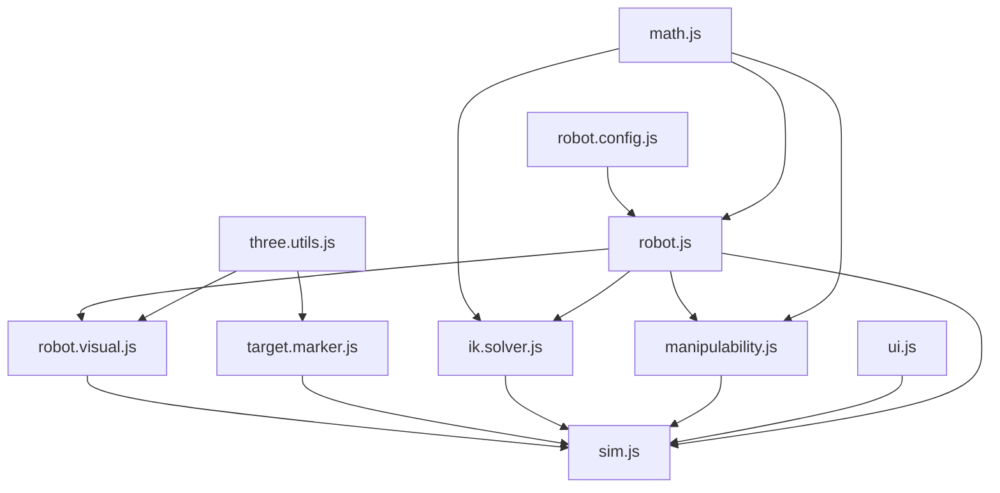

# 5 DOF Arm Studio

```bash
python3 -m http.server 8000
```



```md
src/
├── sim.html
├── sim.css
├── sim.js
├── three.utils.js
├── target.marker.js
├── robot.config.js
├── robot.js
├── robot.visual.js
├── ik.solver.js
├── ellipsoid.visual.js
└── math.js
```
