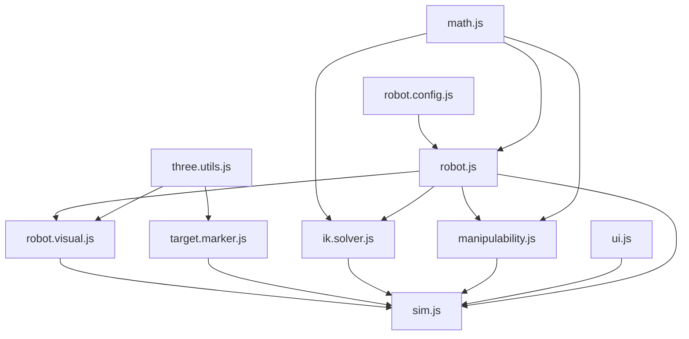

# 5 DOF Arm Studio

```bash
python3 -m http.server 8000
```



```md
├── sim.html
├── sim.css
├── sim.js
├── three.utils.js
├── target.marker.js
├── robot.config.js
├── robot.js
├── robot.visual.js
├── ik.solver.js
├── ellipsoid.visual.js
└── math.js
```

```md
├── sim.html
├── sim.css
├── sim.js                    # archestration
│
├── core/
│   ├── math.js               # RAD, rank() 추가
│   ├── robot.config.js
│   ├── robot.js              # kinematics
│   └── ik.solver.js
│
├── view/
│   ├── three.utils.js
│   ├── robot.visual.js       
│   ├── ellipsoid.visual.js
│   ├── target.marker.js      # 타깃 + position error line

│   ├── scene.stage.js   
│   └── trail.visual.js       # 신규: end-effector 경로
│
└── ui/
    ├── dom.utils.js          # 신규: getElement, setText, setValue, bind ...
    ├── control.panel.js      # 신규: 슬라이더, 파라미터, 타깃 입력, 버튼
    ├── kinematics.panel.js   # 신규: 속도 기구학 표
    └── status.panel.js       # 신규: error, rank, status 표시
```
