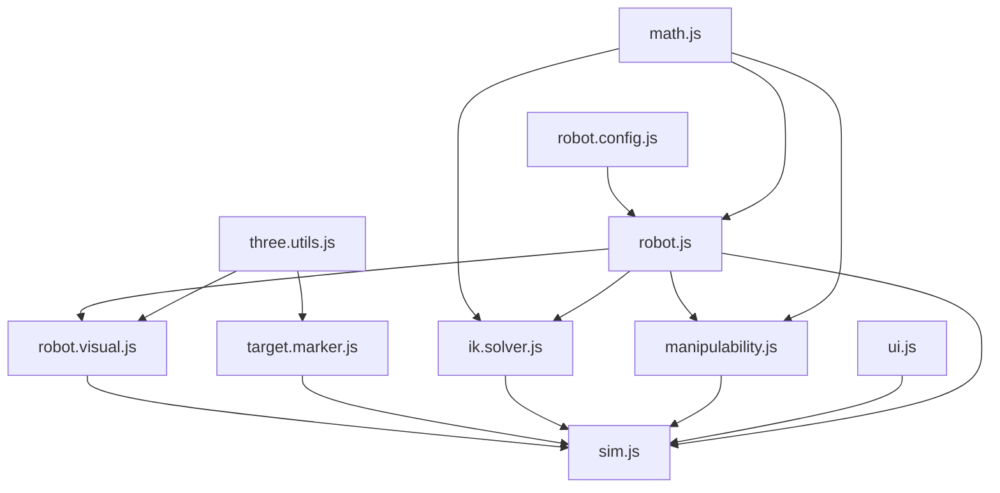

# 5 DOF Arm Studio

```bash
python3 -m http.server 8000
```




```md
├── sim.html
├── sim.css
├── sim.js                    # archestration
├── sim.config.js                    
│
├── core/
│   ├── math.js               # 
│   ├── robot.config.js
│   ├── robot.js              # kinematics
│   └── ik.solver.js
│
└── view/
    ├── three.utils.js
    ├── robot.visual.js       
    ├── ellipsoid.visual.js
    ├── target.marker.js      # 
    ├── scene.stage.js   
    ├── kin.table.js
    ├── dom.utils.js
    └── ui.panel.js
```
